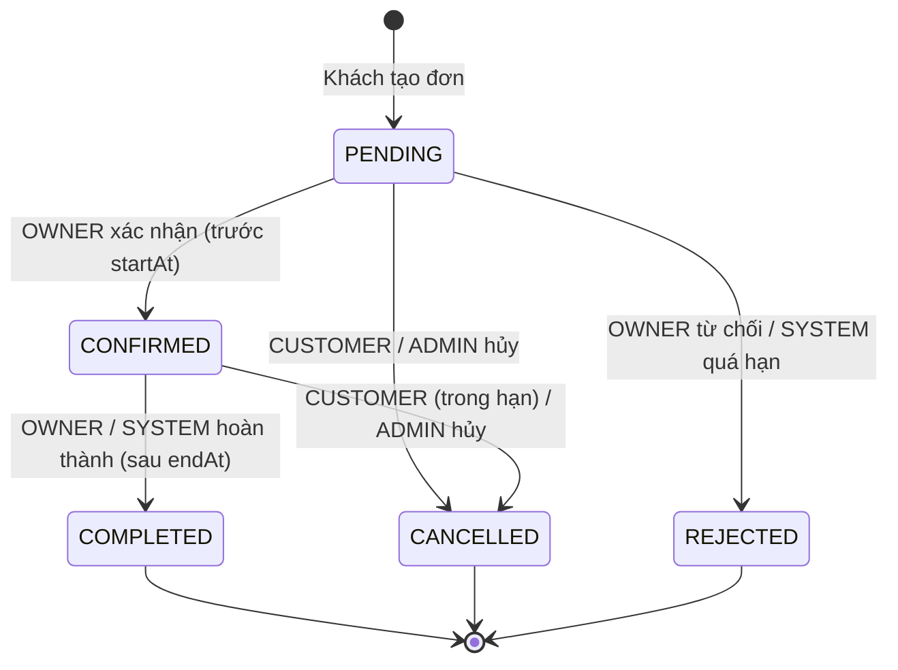

# Báo Cáo Cá Nhân: Dương – Vòng Đời Đơn, Chính Sách Hủy, Đánh Giá, Khiếu Nại, Doanh Thu & Lịch Cố Định

## 1. Giới thiệu đề tài, vai trò và phạm vi sở hữu

**SanGo** là nền tảng đặt lịch sân thể thao trực tuyến (bóng đá mini, cầu lông, pickleball, tennis…) theo kiến trúc SPA (`React 19 + Vite`) kết hợp REST API (`NestJS 11 + Prisma 6 + PostgreSQL 16`) và gói dùng chung `@sango/shared` (TypeScript `strict: true`, Zod).

Trong dự án, **Dương** phụ trách toàn bộ **nghiệp vụ sau khi khách tạo đơn** — từ máy trạng thái đơn, chính sách hủy, lịch sử và quản lý đơn, hệ thống đánh giá, khiếu nại, báo cáo doanh thu chủ sân đến tính năng nâng cao **Đặt lịch cố định hàng tuần**.

### 1.1. Phạm vi sở hữu theo tầng

| Tầng | Thành phần đã triển khai |
|---|---|
| **`shared/`** | `booking/booking-status-machine.ts`, `types/booking-lifecycle.ts`, `types/review.ts`, `types/complaint.ts`, `types/stats.ts`, `types/recurring.ts`, `schemas/booking-lifecycle.schema.ts`, `schemas/review.schema.ts`, `schemas/complaint.schema.ts`, `schemas/stats.schema.ts`, `schemas/recurring.schema.ts` |
| **`DB / Seed`** | Model `Booking` (phần chuyển trạng thái & lý do), `RecurringSeries`, `Review`, `Complaint`; `BE/prisma/seed/bookings.seed.ts`, `BE/prisma/seed/reviews-complaints.seed.ts` |
| **`BE/src/modules/`** | `booking-lifecycle`, `recurring`, `reviews`, `complaints`, `stats` |
| **`FE/src/features/`** | `my-bookings`, `owner-bookings`, `recurring`, `reviews`, `complaints`, `stats` |
| **`Docs`** | `docs/bao-cao/duong.md`, kịch bản video demo |

### 1.2. Hợp đồng giao diện cung cấp cho nhóm

| Thành viên sử dụng | Hợp đồng Dương cung cấp | Mục đích |
|---|---|---|
| Hiếu, Lâm, Hưng | `canTransition`, `assertTransition`, `isTerminalStatus`, `BookingActor`, `BookingAction` (`@sango/shared`) | Kiểm tra và hiển thị trạng thái/hành động hợp lệ đồng nhất FE/BE |
| Hiếu, Hưng | `BookingStatusBadge` (`FE/src/features/my-bookings`) | Hiển thị nhãn và màu trạng thái đơn dùng chung |
| Lâm, Hiếu | `VenueReviews`, `RatingStars` (`FE/src/features/reviews`) | Nhúng khối đánh giá vào trang chi tiết sân và thẻ sân |
| Hiếu | `BookingDetailDrawer` (`FE/src/features/owner-bookings`) | Mở ngăn kéo xem & xử lý nhanh đơn từ lịch sân chủ sân (`/owner/schedule`) |

---

## 2. Bảng phân công công việc & đóng góp nhóm

### 2.1. Phân công theo thành viên

| Thành viên | Phần trọng tâm (khó) | Chức năng bắt buộc | Tính năng nâng cao |
|---|---|---|---|
| **Hưng** | Nền tảng monorepo, Auth/RBAC 4 lớp, Exception Filter, Validation Pipe | Đăng ký/đăng nhập, hồ sơ, Admin (quản lý user, duyệt chủ sân, thống kê tổng) | Gửi email xác nhận (Mailpit/Brevo), CI & Deploy |
| **Hiếu** | Chống đặt trùng (`SlotLock` unique + transaction + 409) & `AvailabilityGrid` (Compound/Render Props) | Tìm kiếm sân, trang chủ, lưới lịch trống, đặt nhiều khung, checkout, lịch sân chủ sân | Giữ chỗ tạm 5 phút (`BookingHold`) |
| **Lâm** | Form bảng giá phức tạp (`superRefine` client/server) & hàm tính giá thuần `calculatePrice` | Quản lý cụm sân, sân con, giờ mở cửa qua đêm, bảng giá, khóa bảo trì, trang chi tiết sân | Bản đồ vị trí sân (Leaflet + OpenStreetMap) |
| **Dương** | **Máy trạng thái đơn** (union type + `Record`) & **Chính sách hủy thuần** | Lịch sử & chi tiết đơn, quản lý đơn chủ sân, cron hoàn thành/từ chối, đánh giá, khiếu nại, doanh thu | **Đặt lịch cố định hàng tuần** (`RecurringSeries`) |

### 2.2. Trạng thái hoàn thành phần việc của Dương

- **Đã hoàn thành đầy đủ (D0 → D8):** Máy trạng thái đơn, chính sách hủy, API & cron vòng đời đơn, trang lịch sử & chi tiết đơn của khách, trang quản lý đơn của chủ sân, seed dữ liệu đơn/đánh giá/khiếu nại, module đánh giá, module khiếu nại (khách + admin), dashboard doanh thu chủ sân, và đặt lịch cố định hàng tuần kèm unit test/component test.
- **Chưa hoàn thành:** Quay & dựng file video demo thực tế (đã chuẩn bị kịch bản chi tiết ở Mục 7).

### 2.3. Thống kê commit tham khảo (`git shortlog -sn HEAD`)

Tại thời điểm viết báo cáo, lịch sử commit trên repository ghi nhận:

| Tác giả Git | Số commit |
|---|---:|
| `Hng2725` | 7 |
| `NPLam01` | 2 |
| `MTH209` | 1 |
| `dpham8473` | 1 |

*(Ghi chú: Thống kê `git shortlog` phản ánh lịch sử gộp commit hiện có trên nhánh hiện tại, không thay thế phân bổ khối lượng công việc thực tế theo bảng phân công ở mục 2.1.)*

---

## 3. Máy trạng thái đơn & vòng đời đơn (`booking-lifecycle`)

### 3.1. Sơ đồ chuyển trạng thái hợp lệ



### 3.2. Thiết kế an toàn kiểu tại `@sango/shared`

Trong `shared/src/booking/booking-status-machine.ts`, toàn bộ quy tắc chuyển trạng thái được khai báo bằng **Union Type** kết hợp **`Record<BookingStatus, Partial<Record<BookingStatus, readonly BookingActor[]>>>`**:

```ts
export type BookingActor = 'CUSTOMER' | 'OWNER' | 'ADMIN' | 'SYSTEM';

export const BOOKING_TRANSITIONS: Record<
  BookingStatus,
  Partial<Record<BookingStatus, readonly BookingActor[]>>
> = {
  PENDING: {
    CONFIRMED: ['OWNER'],
    REJECTED: ['OWNER', 'SYSTEM'],
    CANCELLED: ['CUSTOMER', 'ADMIN'],
  },
  CONFIRMED: {
    CANCELLED: ['CUSTOMER', 'ADMIN'],
    COMPLETED: ['OWNER', 'SYSTEM'],
  },
  COMPLETED: {},
  CANCELLED: {},
  REJECTED: {},
};
```

Cách thiết kế này mang lại 3 lợi ích trực tiếp:
1. **Ép đủ trạng thái lúc biên dịch:** Nếu thêm một `BookingStatus` mới mà quên khai báo trong `BOOKING_TRANSITIONS`, TypeScript (`strict: true`) báo lỗi biên dịch ngay lập tức.
2. **Dùng chung FE & BE:** Backend dùng `assertTransition` để chặn chuyển sai; Frontend và hàm thuần `getAllowedActions` dùng `canTransition` và `isTerminalStatus` để đồng bộ logic hiển thị.
3. **Lỗi có ngữ cảnh rõ ràng:** `InvalidTransitionError` lưu sẵn `from`, `to`, `actor` để tầng service map sang HTTP `409 Conflict` (`INVALID_STATUS_TRANSITION`).

### 3.3. Quy trình `BookingLifecycleService.transitionInTx` & Khóa lạc quan

Mọi thao tác đổi trạng thái (`confirm`, `reject`, `cancel`, `complete`, kể cả từ Cron) đều đi qua một điểm duy nhất là `BookingLifecycleService.transition` → `transitionInTx` (`BE/src/modules/booking-lifecycle/booking-lifecycle.service.ts`) bên trong `prisma.$transaction`:

1. **Tải đơn & kiểm tra tồn tại:** Truy vấn `booking` kèm `court.venue`. Không tồn tại → `404 NOT_FOUND`.
2. **Phân quyền ở tầng dữ liệu:**
   - `CUSTOMER` phải trùng `booking.customerId`.
   - `OWNER` phải trùng `booking.court.venue.ownerId`.
   - Vi phạm → `403 FORBIDDEN`.
3. **Kiểm tra máy trạng thái:** Gọi `assertTransition(booking.status, to, actor)`. Nếu ném `InvalidTransitionError` → trả `409 INVALID_STATUS_TRANSITION`.
4. **Kiểm tra điều kiện thời gian & chính sách hủy:**
   - `CONFIRMED`: yêu cầu `booking.startAt > now` (không thể xác nhận đơn đã tới hoặc qua giờ chơi).
   - `COMPLETED`: yêu cầu `booking.endAt <= now` (chỉ hoàn thành sau khi kết thúc giờ chơi).
   - `CANCELLED` (`CUSTOMER` / `ADMIN`): gọi hàm thuần `evaluateCancellation`; nếu không hợp lệ trả `409 CANCELLATION_NOT_ALLOWED` kèm `{ reason, deadline }`.
5. **Cập nhật với Khóa lạc quan (Optimistic Locking):**
   ```ts
   const result = await tx.booking.updateMany({
     where: { id: bookingId, status: booking.status },
     data: updateData,
   });
   if (result.count === 0) {
     throw new AppException(
       HttpStatus.CONFLICT,
       'INVALID_STATUS_TRANSITION',
       'Trạng thái đơn vừa được thay đổi, vui lòng tải lại',
     );
   }
   ```
   Nhờ điều kiện `where: { id: bookingId, status: booking.status }`, nếu hai request (ví dụ: khách bấm hủy và chủ sân bấm xác nhận) chạy song song tại cùng thời điểm, chỉ request đến trước cập nhật thành công; request còn lại nhận `count === 0` và bị từ chối với HTTP **409 Conflict**, tránh ghi đè trạng thái chéo.
6. **Giải phóng khóa khung giờ & phát sự kiện:**
   - Nếu trạng thái đích là `CANCELLED` hoặc `REJECTED`, gọi `this.slotLockService.releaseBooking(tx, bookingId)` ngay trong cùng transaction để trả lại khung giờ trống lên lưới lịch.
   - Sau khi transaction commit thành công, phát sự kiện `AppEvents.BookingConfirmed | Rejected | Cancelled | Completed` qua `EventEmitter2` để module mail gửi thông báo bất đồng bộ.

### 3.4. Cron tự động & hàm thuần `getAllowedActions`

- **`BookingLifecycleCron`** (`BE/src/modules/booking-lifecycle/booking-lifecycle.cron.ts`): Chạy mỗi 10 phút (`@Cron('*/10 * * * *')`):
  - Đơn `CONFIRMED` có `endAt <= now` → chuyển sang `COMPLETED` với actor `SYSTEM`.
  - Đơn `PENDING` có `startAt <= now` → chuyển sang `REJECTED` với actor `SYSTEM`, `rejectReason = 'Quá hạn xác nhận'` và tự động giải phóng `SlotLock`.
- **`getAllowedActions`** (`BE/src/modules/booking-lifecycle/allowed-actions.ts`): Hàm thuần tổng hợp `canTransition`, điều kiện thời gian (`startAt > now`, `endAt <= now`), `evaluateCancellation` và trạng thái `hasReview` để trả về mảng `BookingAction[]` (`CONFIRM`, `REJECT`, `CANCEL`, `COMPLETE`, `REVIEW`, `COMPLAIN`) cho từng DTO.

---

## 4. Chính sách hủy đơn (`cancellation-policy.ts`)

### 4.1. Quy tắc nghiệp vụ và kiểu trả về

Chính sách hủy được tách thành hàm thuần tại `BE/src/modules/booking-lifecycle/cancellation-policy.ts`, không phụ thuộc I/O hay CSDL, trả về discriminated union `CancellationDecision`:

```ts
export type CancellationDecision =
  | { allowed: true; deadline: Date | null }
  | {
      allowed: false;
      reason: 'INVALID_STATUS' | 'ALREADY_STARTED' | 'TOO_LATE';
      deadline: Date | null;
    };

export function getCancelDeadline(startAt: Date, cancelBeforeHours: number): Date {
  return new Date(startAt.getTime() - cancelBeforeHours * 3600_000);
}
```

Thứ tự đánh giá trong `evaluateCancellation`:
1. Nếu `status` không thuộc `PENDING | CONFIRMED` → `{ allowed: false, reason: 'INVALID_STATUS', deadline: null }`.
2. Tính `deadline = status === 'CONFIRMED' ? getCancelDeadline(startAt, cancelBeforeHours) : null`.
3. Nếu `now >= startAt` → `{ allowed: false, reason: 'ALREADY_STARTED', deadline }` (áp dụng cho cả `CUSTOMER` và `ADMIN`).
4. Nếu `actor === 'ADMIN'` → `{ allowed: true, deadline }` (Admin bỏ qua mốc `cancelBeforeHours`, miễn trước giờ chơi).
5. Nếu `status === 'PENDING'` → `{ allowed: true, deadline: null }` (chủ sân chưa xác nhận nên khách được hủy trước giờ chơi).
6. Với `CONFIRMED`: nếu `now <= deadline` → `{ allowed: true, deadline }`, ngược lại → `{ allowed: false, reason: 'TOO_LATE', deadline }`.

### 4.2. Bảng các ca kiểm thử biên (`cancellation-policy.spec.ts`)

| STT | Tình huống kiểm thử | Đầu vào chính | Kết quả mong đợi |
|:---:|:---|:---|:---|
| 1 | Hủy `CONFIRMED` trước mốc | `startAt = 18:00 VN`, `cancelBeforeHours = 2`, `now` trước 3h | `allowed: true`, `deadline = 16:00 VN` |
| 2 | Hủy `CONFIRMED` đúng bằng mốc | `now === deadline` | `allowed: true` |
| 3 | Hủy `CONFIRMED` quá mốc 1 phút (sát giờ) | `now = deadline + 60s` | `allowed: false`, `reason: 'TOO_LATE'` |
| 4 | Hủy đúng thời điểm bắt đầu | `now === startAt` | `allowed: false`, `reason: 'ALREADY_STARTED'` |
| 5 | Hủy sau khi đã qua giờ chơi | `status = 'PENDING'`, `now = startAt + 30p` | `allowed: false`, `reason: 'ALREADY_STARTED'` |
| 6 | Hủy đơn `PENDING` sát giờ | `now = startAt - 10p`, `cancelBeforeHours = 2` | `allowed: true`, `deadline: null` |
| 7 | Sân cấu hình `cancelBeforeHours = 0` | `status = 'CONFIRMED'`, `now = startAt - 1s` | `allowed: true`, `deadline = startAt` |
| 8 | Đơn ở trạng thái kết thúc | `COMPLETED`, `CANCELLED`, `REJECTED` | `allowed: false`, `reason: 'INVALID_STATUS'` |
| 9 | `ADMIN` hủy quá mốc / tại `startAt` | `now = startAt - 5p` và `now === startAt` | Trước giờ chơi: `allowed: true`; tại `startAt`: `ALREADY_STARTED` |
| 10 | Đơn qua nửa đêm (lệch ngày UTC/VN) | `startAt = 00:00 VN (21/11)` = `17:00 UTC (20/11)`, `cancelBeforeHours = 2` | `deadline = 22:00 VN (20/11)`; 21:59:59 hợp lệ, 22:00:01 trả `TOO_LATE` |

---

## 5. Các chức năng nghiệp vụ & giao diện đã triển khai

### 5.1. Lịch sử đặt & chi tiết đơn của khách (`features/my-bookings`)

- **`MyBookingsPage` (`/me/bookings`):** Lọc trạng thái đồng bộ URL, phân trang, hiển thị thẻ đơn kèm `BookingStatusBadge`.
- **`BookingDetailPage` (`/me/bookings/:id`):** Hiển thị thông tin sân, chi tiết breakdown giá theo từng khung giờ, timeline chuyển trạng thái, thông báo hạn hủy miễn phí (`detail.cancelDeadline`), liên kết tới chuỗi lịch cố định (nếu có), và các nút hành động dựa theo `detail.allowedActions`:
  - **Hủy đơn:** Mở modal nhập lý do (tối đa 300 ký tự), gọi `PATCH /bookings/:id/cancel`; nếu server trả 409 (ví dụ quá hạn), hiển thị thông báo lỗi ngay trong modal.
  - **Đánh giá:** Mở `ReviewForm` (chỉ xuất hiện khi `COMPLETED` và chưa đánh giá).
  - **Khiếu nại:** Mở `ComplaintForm` điền sẵn `venueId` và `bookingId`.

### 5.2. Quản lý đơn của chủ sân (`features/owner-bookings`)

- **`OwnerBookingsPage` (`/owner/bookings`):** Bộ lọc đa tiêu chí đồng bộ URL (`status`, `venueId`, `courtId`, khoảng ngày `DatePicker.RangePicker`, ô tìm kiếm mã đơn/tên/SĐT dùng `useDebounce(..., 400)`), tab nhanh `Segmented`, phân trang server (`pageSize = 20`), modal từ chối đơn (bắt buộc lý do 3–300 ký tự).
- **`OwnerBookingsList`:** Hiển thị bảng đơn quản trị rõ ràng (mã đơn, khách hàng, SĐT, sân & thời gian, giá trị, `BookingStatusBadge`, nhãn `Cố định` nếu thuộc `recurringSeriesId`), hỗ trợ cuộn/highlight đơn khi có `?highlight=<id>`, và các nút thao tác theo `allowedActions` (`Xác nhận`, `Cả chuỗi`, `Từ chối`, `Hoàn thành`).
- **`BookingDetailDrawer`:** Component export để Hiếu tái sử dụng tại màn hình `/owner/schedule`, cho phép xem chi tiết đơn và xử lý trực tiếp trên lưới lịch.

### 5.3. Đánh giá sân (`modules/reviews`, `features/reviews`)

- **Backend (`ReviewsService`):** Kiểm tra đơn thuộc về user, ở trạng thái `COMPLETED` và chưa có review (vi phạm trả `409 REVIEW_NOT_ALLOWED`). Trong `prisma.$transaction`, tạo/cập nhật/xóa review đồng thời gọi `recalculateVenueRating` (`aggregate` `_avg` và `_count`) để cập nhật `avgRating` và `reviewCount` trên bảng `Venue`. Hỗ trợ chủ sân phản hồi (`PATCH /owner/reviews/:id/reply`) có kiểm tra quyền sở hữu cụm sân (`403 FORBIDDEN`).
- **Frontend:**
  - `RatingStars`: Thiết kế `role="radiogroup"` chuẩn accessibility, hỗ trợ chọn sao bằng chuột và bàn phím (`ArrowRight`/`ArrowUp`/`ArrowLeft`/`ArrowDown`).
  - `ReviewForm`: Dùng `react-hook-form` + `zodResolver(createReviewSchema)`.
  - `VenueReviews`: Hiển thị điểm trung bình, thanh phân bố 1–5 sao, danh sách đánh giá kèm phản hồi chủ sân và nút `"Xem thêm"` phân trang cộng dồn.
  - `OwnerReviewsPage` (`/owner/reviews`): Chủ sân lọc đánh giá và phản hồi trực tiếp.

### 5.4. Khiếu nại (`modules/complaints`, `features/complaints`)

- **Schema dùng chung (`complaint.schema.ts`):** `createComplaintSchema` (tiêu đề 5–120 ký tự, nội dung 10–2000 ký tự) và `adminUpdateComplaintSchema` dùng `.refine()` bắt buộc `adminResponse >= 3` ký tự khi chuyển sang `RESOLVED` hoặc `REJECTED`.
- **Máy trạng thái khiếu nại (`COMPLAINT_TRANSITIONS`):** `OPEN → IN_PROGRESS | RESOLVED | REJECTED`, `IN_PROGRESS → RESOLVED | REJECTED`. `ComplaintsService.adminUpdate` từ chối chuyển sai bằng `409 INVALID_STATUS_TRANSITION`, đồng thời lưu `handledById` và `resolvedAt`.
- **Frontend:** `ComplaintForm`, `MyComplaintsPage` (`/me/complaints`), `AdminComplaintsPage` (`/admin/complaints`).

### 5.5. Doanh thu & Dashboard chủ sân (`modules/stats`, `features/stats`)

- **Validate khoảng thời gian (`revenueQuerySchema`):** Dùng `.refine()` đảm bảo `from <= to`, tối đa **92 ngày** khi `groupBy = 'day'` và tối đa **24 tháng** khi `groupBy = 'month'`.
- **Hàm thuần `groupRevenue` (`BE/src/modules/stats/revenue-grouping.ts`):** Chuyển `startAt` sang ngày/tháng giờ Việt Nam bằng `toVnParts`, cộng dồn `revenue` và `bookingCount`, đồng thời **lấp đầy các ngày/tháng không có đơn bằng giá trị `0`** để biểu đồ liên tục và sắp xếp tăng dần.
- **`StatsService`:** Truy vấn đơn `COMPLETED` trong khoảng `[fromUtc, toUtc)` tính theo `vnDateMinuteToUtc`, tính `expectedRevenue` từ các đơn `CONFIRMED` trong tương lai, và `summary` (số đơn hôm nay, số đơn chờ xác nhận, doanh thu tháng hiện tại, điểm đánh giá trung bình có trọng số theo `reviewCount`).
- **Frontend:** `OwnerDashboardPage` (`/owner`) hiển thị 4 thẻ KPI, biểu đồ lượt đặt 7/14 ngày, danh sách việc cần xử lý (`?highlight=<id>`), danh sách cụm sân; kèm `RevenueChart` dùng `recharts` (`ResponsiveContainer`).

### 5.6. Đặt lịch cố định hàng tuần (`modules/recurring`, `features/recurring` – Nâng cao)

- **Sinh lịch thuần (`buildWeeklyOccurrences`):** Tính danh sách `{ date, startAt, endAt }` cho `weeks` tuần (2–12 tuần) qua `addDaysToDateStr` và `vnDateMinuteToUtc`, đảm bảo chính xác khi đổi tháng hoặc ca qua nửa đêm.
- **Xem trước (`RecurringService.preview`):** Với từng tuần, kiểm tra lần lượt điều kiện mở cửa/bảo trì/quá khứ (`BookingsService.assertSlotsBookable`), khóa lịch (`SlotLockService.findLocked`) và báo giá (`PricingService.quote`), trả về `RecurringPreviewDto` gồm lý do xung đột (`BOOKED | MAINTENANCE | CLOSED | PAST`) và `totalAvailablePrice`.
- **Tạo chuỗi (`RecurringService.create`):**
  - Nếu có tuần trùng mà `skipConflicts = false` → trả `409 SLOT_ALREADY_BOOKED` kèm `details.conflictedDates`.
  - Nếu hợp lệ → gói vào **một `prisma.$transaction`**: tạo `RecurringSeries` và gọi `BookingsService.createBookingInTx` cho từng tuần trống; nếu có race condition (`P2002`) → rollback toàn bộ và trả 409.
- **Hủy & xác nhận chuỗi:**
  - `cancelSeries`: Duyệt các đơn tương lai của chuỗi; đơn nào `evaluateCancellation` cho phép thì chuyển sang `CANCELLED` (giải phóng `SlotLock`), đơn quá hạn hủy được giữ nguyên và thống kê số lượng hủy/bỏ qua.
  - `confirmSeries`: Chủ sân xác nhận hàng loạt các đơn `PENDING` tương lai thuộc chuỗi.
- **Giao diện:** `NewRecurringPage` (`/me/recurring/new`) tự động gọi preview với **debounce 300ms** khi thay đổi số tuần/ngày/số khung, hiển thị bảng xem trước từng tuần và checkbox `"Bỏ qua tuần bị trùng"`; `MyRecurringPage` (`/me/recurring`) quản lý và hủy chuỗi.

---

## 6. Dữ liệu mẫu (Seed) & Kết quả kiểm thử

### 6.1. Dữ liệu mẫu (`BE/prisma/seed/`)

- **`bookings.seed.ts`:** Tạo 2 `RecurringSeries` mẫu cho `customer@sango.vn` và sinh bộ đơn mục tiêu **340 đơn** trải từ **60 ngày trước đến 14 ngày sau**, tôn trọng giờ mở cửa qua `generateDaySlots`, tránh trùng khung giờ bằng tập `occupied` (`courtId|startAt`), tính giá bằng hàm thuần `calculatePrice`, gán trạng thái hợp lý theo thời gian và tạo `SlotLock` tương ứng.
- **`reviews-complaints.seed.ts`:** Tạo đánh giá cho ~40% đơn `COMPLETED` (kèm một số phản hồi chủ sân), cập nhật lại `avgRating`/`reviewCount` cho tất cả cụm sân, và tạo **12 khiếu nại** chia đều 4 trạng thái (`OPEN`, `IN_PROGRESS`, `RESOLVED`, `REJECTED`).

### 6.2. Các bộ kiểm thử đã xây dựng cho phần việc của Dương

| Workspace | File test | Nội dung kiểm thử chính |
|---|---|---|
| `shared` | `booking-status-machine.test.ts` | Duyệt toàn bộ $5 \times 5 \times 4 = 100$ tổ hợp chuyển trạng thái, trạng thái kết thúc, `InvalidTransitionError` |
| `BE` | `cancellation-policy.spec.ts` | 10 ca biên chính sách hủy (đúng mốc, quá mốc 1 phút, `startAt`, qua nửa đêm, `ADMIN`, `cancelBeforeHours = 0`) |
| `BE` | `allowed-actions.spec.ts` | Tính toán `BookingAction[]` theo vai trò và thời gian |
| `BE` | `booking-lifecycle.service.spec.ts` | Phân quyền 403, chuyển sai 409, hủy quá hạn 409, giải phóng `SlotLock`, khóa lạc quan `count === 0`, cron |
| `BE` | `revenue-grouping.spec.ts` | Nhóm doanh thu theo ngày/tháng giờ VN (23:30 VN, 00:30 VN ngày 1), lấp ngày trống = 0 |
| `BE` | `reviews.service.spec.ts` | Chặn review đơn chưa `COMPLETED`, chặn review trùng 409, tính lại `avgRating` |
| `BE` | `complaints.service.spec.ts` | Kiểm tra sở hữu đơn/sân khi tạo khiếu nại, chặn chuyển trạng thái sai của Admin |
| `BE` | `recurring-dates.spec.ts` & `recurring.service.spec.ts` | Sinh lịch qua tháng/nửa đêm, all-or-nothing trả 409, `skipConflicts`, `cancelSeries` bỏ qua đơn quá hạn |
| `FE` | `BookingStatusBadge.test.tsx` & `BookingDetailPage.test.tsx` | Hiển thị badge, tương tác hủy đơn qua MSW (thành công & lỗi 409) |
| `FE` | `OwnerBookingsList.test.tsx` | Render danh sách 300 đơn mẫu trên bảng quản trị |
| `FE` | `RatingStars.test.tsx` | Chọn sao bằng click và phím mũi tên bàn phím |
| `FE` | `NewRecurringPage.test.tsx` | Debounce preview hiển thị ngày còn trống và ngày bị trùng |

### 6.3. Kết quả chạy kiểm thử gần nhất

Chạy toàn bộ suite bằng `npm test`:
- **`@sango/shared`:** 8 test files — **33/33 tests passed**.
- **`@sango/be`:** 30 test suites — **154/154 tests passed**.
- **`@sango/fe`:** Đang chạy kiểm tra bằng Vitest (`@testing-library/react` + MSW) cùng `npm run build`.

---

## 7. Kịch bản video demo 5–10 phút

1. **Đặt sân & chống trùng (1,5 phút):** Khách (`customer@sango.vn`) tìm sân, xem lưới lịch trống `AvailabilityGrid`, giữ chỗ tạm 5 phút và tạo đơn thành công.
2. **Xử lý đơn của chủ sân (1,5 phút):** Chủ sân (`owner@sango.vn`) mở `/owner/bookings`, lọc theo trạng thái/từ khóa, xem chi tiết qua `BookingDetailDrawer` và bấm **Xác nhận** đơn.
3. **Chi tiết đơn & Chính sách hủy (1 phút):** Khách mở `/me/bookings/:id`, xem breakdown giá, timeline, hạn hủy miễn phí; thử hủy đơn trong hạn thành công (khung giờ mở lại trên lưới) và minh họa trường hợp quá hạn bị trả lỗi 409.
4. **Đánh giá & Khiếu nại (1,5 phút):** Trên đơn `COMPLETED`, khách gửi đánh giá bằng `RatingStars` (bàn phím/chuột) → chủ sân phản hồi tại `/owner/reviews`; khách tạo khiếu nại → Admin (`admin@sango.vn`) xử lý chuyển trạng thái và nhập phản hồi tại `/admin/complaints`.
5. **Dashboard doanh thu (1 phút):** Chủ sân mở `/owner`, xem 4 thẻ KPI, đổi khoảng 7/14 ngày và danh sách việc cần xử lý.
6. **Đặt lịch cố định hàng tuần (1,5 phút):** Khách mở `/me/recurring/new`, chọn số tuần để xem bảng preview tự động đánh dấu tuần trùng lịch, bật **"Bỏ qua tuần bị trùng"** để tạo chuỗi; chủ sân xác nhận cả chuỗi.
7. **Kiểm thử đặt trùng đồng thời (1 phút):** Chạy `npx tsx scripts/race-booking.ts --n 20` trong `BE/` để chứng minh 20 request đồng thời chỉ có 1 request `201 Created` và 19 request nhận `409 Conflict`.
