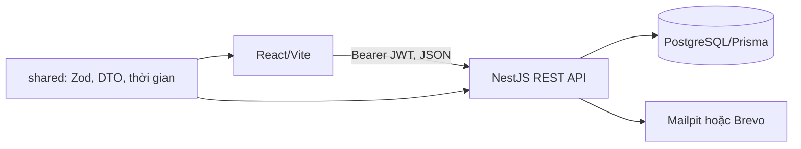
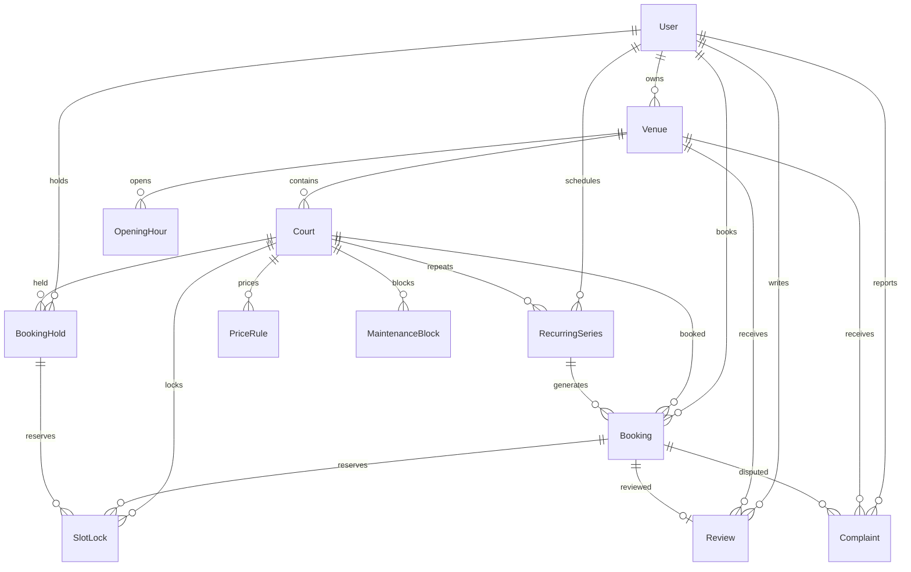

# Phần Hưng: nền tảng, xác thực và quản trị

## Kiến trúc

`shared` chứa kiểu dữ liệu, schema validate và các hàm giờ Việt Nam thuần; FE và BE dùng cùng một hợp đồng. Prisma schema giữ các quan hệ User–Venue–Court–Booking, trong đó SlotLock có unique `(courtId, startAt)` để các module đặt sân chống trùng.

Cấu trúc mã nguồn: `shared/src` giữ hợp đồng API; `BE/src/common` giữ guard, pipe, filter, interceptor và event; `BE/src/modules` giữ các chức năng; `FE/src/app` ghép router/store/providers; `FE/src/common` giữ UI kit, hook và API nền; `FE/src/features` tách từng màn hình nghiệp vụ. Module của Hiếu, Lâm và Dương có thể thêm vào `AppModule` và router theo hợp đồng chung.

### Sơ đồ CSDL

Quan hệ và ràng buộc đầy đủ nằm ở `BE/prisma/schema.prisma`; migration đầu tiên ở `BE/prisma/migrations/20261117000000_init`. Đặc biệt `SlotLock` có unique `(courtId, startAt)`, `Review` có unique `bookingId`, và `OpeningHour` có unique `(venueId, dayOfWeek)`.

## Phân quyền

Guard JWT ở `BE/src/common/guards/jwt-auth.guard.ts` yêu cầu đăng nhập mặc định, đọc user thật từ DB mỗi request và chặn tài khoản LOCKED. `RolesGuard` kiểm tra vai trò và trạng thái duyệt OWNER. Service quản trị còn kiểm tra ADMIN trước khi truy vấn hoặc thay đổi tài khoản. `withAuthGuard` ở FE điều hướng người dùng tới trang đăng nhập, 403 hoặc trang chờ duyệt; BE vẫn là nguồn quyết định quyền.

| Quyền | Khách | Chủ sân chờ duyệt | Chủ sân đã duyệt | Admin |
|---|---:|---:|---:|---:|
| Trang công khai, đăng ký, đăng nhập | Có | Có | Có | Có |
| Hồ sơ cá nhân | Có | Có | Có | Có |
| Khu vực chủ sân | Không | Chỉ trang chờ duyệt | Có | Không |
| Quản trị người dùng, thống kê | Không | Không | Không | Có |

Bốn lớp bảo vệ là xác thực JWT và kiểm tra trạng thái tài khoản, guard vai trò/trạng thái duyệt chủ sân, kiểm tra quy tắc nghiệp vụ trong service, rồi ràng buộc CSDL cùng Zod cho dữ liệu đầu vào. Ví dụ `RolesGuard` trả `OWNER_NOT_APPROVED` khi chủ sân chưa được duyệt; `AdminUsersService` chặn admin tự khóa mình và khóa admin khác. FE guard chỉ hỗ trợ điều hướng, không thay thế kiểm tra tại API.

## Chọn state

Redux Toolkit giữ phiên đăng nhập, RTK Query giữ dữ liệu máy chủ và cache theo tag. Context giữ theme và ngôn ngữ vì hai giá trị này đổi ít nhưng cần ở toàn bộ giao diện. HOC `withAuthGuard` dùng lại logic bảo vệ các layout mà không đổi props của trang.

TypeScript dùng `paginate<T>` để giữ kiểu phần tử qua phân trang; `AuthUser = Pick<UserDto, ...>` giới hạn dữ liệu của request; `isApiResponse<T>` và `isApiErrorBody` thu hẹp kiểu dữ liệu chưa tin cậy. `shared` xuất enum, DTO và schema Zod cho FE/BE dùng cùng một định nghĩa, tránh lệch hợp đồng khi nhóm thêm module.

## Xử lý API

`ZodValidationPipe` kiểm tra đầu vào bằng schema shared. `TransformInterceptor` bọc thành công trong `{ data }`; `AllExceptionsFilter` chuẩn hóa lỗi, map Prisma P2002/P2025 và không gửi stack cho client. `paginate<T>` là generic cho danh sách; type guard trong shared kiểm tra envelope và mã lỗi trước khi FE hiển thị.

## Email

Module mail lắng nghe event sau cập nhật nghiệp vụ, tạo HTML có escape dữ liệu người dùng và gửi qua SMTP hoặc Brevo. Lỗi gửi được ghi log trong listener, không làm hỏng request. `MAIL_ENABLED=false` chỉ ghi log.

## Kiểm tra và triển khai

CI chạy lint, test và build trên Node 22. Tại máy phát triển, `npm run lint`, `npm test`, `npm run build` và `npm run test:cov` đều qua; coverage statements lần lượt là shared 90,47%, BE 76,43%, FE 79,79%. Đã thử luồng thực tế với PostgreSQL và Mailpit: đăng ký chủ sân → trạng thái PENDING → admin duyệt → trạng thái APPROVED và email được ghi vào Mailpit. API trả 401 khi thiếu token, 403 khi sai vai trò và 409 khi email trùng.

Hướng dẫn triển khai Neon, Render, Vercel ở README. Link dịch vụ và số liệu Lighthouse cần bổ sung khi nhóm đã có repo GitHub, tài khoản dịch vụ, bản chạy công khai cùng các trang tìm sân/chi tiết sân của thành viên khác. Tỉ lệ lấp sân trong dashboard hiện trả `null` đến khi hàm tạo slot của Hiếu được ghép vào.
