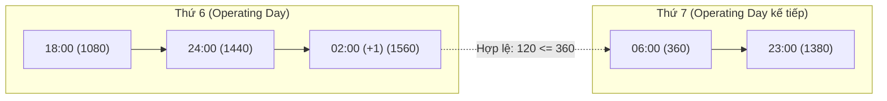

# Phần Lâm: Quản lý cụm sân, sân con, giờ mở cửa, bảng giá và bản đồ

## 1. Mô hình giờ mở cửa & "ngày hoạt động" qua nửa đêm

Trong nghiệp vụ sân thể thao (đặc biệt là sân bóng đá, cầu lông, pickleball), nhiều cơ sở mở cửa đến 01:00 hoặc 02:00 sáng hôm sau. Để quản lý chính xác mà không gây nhầm lẫn về ngày đặt sân, SanGo áp dụng khái niệm **"Ngày hoạt động" (Operating Day)**:

- Một ca hoạt động thuộc về ngày mở cửa (`dayOfWeek` từ 0 đến 6, với 0 là Chủ Nhật, 1 là Thứ Hai,...).
- `openMinute`: Phút mở cửa tính từ 00:00 của ngày bắt đầu (0 – 1380, bội số 60 phút, ví dụ `18:00` = 1080).
- `closeMinute`: Phút đóng cửa tính từ 00:00 của ngày bắt đầu. Nếu đóng cửa qua nửa đêm sang rạng sáng hôm sau, `closeMinute > 1440` (ví dụ `02:00` sáng hôm sau = `1440 + 120 = 1560`).
- Giao diện người dùng tự động chuyển đổi hiển thị:
  - Giờ mở: `18:00`
  - Giờ đóng: `02:00 (+1)`
  - Thời lượng hoạt động: `(1560 - 1080) / 60 = 8` giờ liên tục.
- **Ràng buộc toàn vẹn (Validation):**
  - Ca qua nửa đêm không được chồng lấn vào giờ mở cửa của ngày tiếp theo: `closeMinute - 1440 <= nextDay.openMinute`.
  - Ngày tiếp theo không được là ngày nghỉ (`isClosed = false`), vì ca qua nửa đêm cần cơ sở vật chất mở cửa liên tục.



---

## 2. Mô hình bảng giá và hàm tính giá thuần (`calculatePrice`)

### 2.1. Kiến trúc phân tách

Bảng giá sân gồm giá cơ sở `basePricePerHour` và danh sách các quy tắc đặc biệt `PriceRule` theo khung giờ:
- `dayType`: `WEEKDAY` (Thứ 2 – Thứ 6) hoặc `WEEKEND` (Thứ 7, Chủ Nhật).
- `startMinute` và `endMinute`: Khoảng thời gian nửa mở `[startMinute, endMinute)`.
- `pricePerHour`: Giá áp dụng cho khung giờ đó.
- `label`: Nhãn hiển thị trực quan (ví dụ: *"Giờ vàng"*, *"Cuối tuần"*).

Hàm tính giá `calculatePrice` được thiết kế dưới dạng **Pure Function (hàm thuần không phụ thuộc I/O hay CSDL)** đặt tại `BE/src/modules/pricing/pricing.calculator.ts` và dùng hàm xác định rule khớp `findMatchingPriceRule` tại `@sango/shared/utils/pricing-match.ts`:

- Nhận vào: `(pricing: PricingInput, startAt: Date, endAt: Date)`.
- Tách đơn đặt thành từng slot 60 phút rời rạc bằng `enumerateSlotStarts(startAt, endAt)`.
- Chuyển đổi slot sang giờ Việt Nam qua `toVnParts(slotStart)` để xác định đúng thứ trong tuần (`dayType`) và phút trong ngày (`minuteOfDay`).
- Không bị lệch múi giờ (Timezone safe) ngay cả khi server chạy tại múi giờ UTC.
- Trả về cấu trúc chi tiết `PriceQuote` gồm `total` và mảng `breakdown` từng khung kèm nhãn.
- Ném lỗi `InvalidPriceRangeError` nếu khoảng thời gian không hợp lệ (`end <= start` hoặc không chia hết 60 phút).

### 2.2. Bảng các ca kiểm thử biên (Edge Cases)

Bộ kiểm thử tại `BE/src/modules/pricing/pricing.calculator.spec.ts` đạt **100% Statements / Lines** với 11 trường hợp bao phủ toàn diện:

| STT | Tình huống kiểm thử | Dữ liệu đầu vào | Kết quả mong đợi |
|:---:|:---|:---|:---|
| 1 | Ngày thường không khớp rule | Thứ 4 08:00–10:00, base 100k | 2 khung base = 200k, label `null` |
| 2 | Khung nằm trọn trong giờ vàng | Thứ 4 17:00–20:00, rule 17:00–21:00 150k | 3 khung 150k = 450k, label *"Giờ vàng"* |
| 3 | Đơn cắt ngang mốc bắt đầu giờ vàng | Thứ 4 16:00–18:00 (16h base, 17h vàng) | 1 khung 100k + 1 khung 150k = 250k |
| 4 | Bắt đầu đúng bằng `endMinute` của rule | Thứ 4 21:00–22:00, rule kết thúc lúc 21:00 | Tính giá base (khoảng nửa mở `[start, end)`) |
| 5 | Thứ 7 chỉ áp rule `WEEKEND` | Thứ 7 18:00–19:00, có cả rule WEEKDAY và WEEKEND | Áp đúng rule WEEKEND 180k, bỏ qua rule WEEKDAY |
| 6 | Đơn qua nửa đêm T6 → T7 | T6 23:00 – T7 01:00 | Khung 23h tính giá WEEKDAY, khung 0h tính giá WEEKEND |
| 7 | Đơn qua nửa đêm CN → T2 | CN 23:00 – T2 01:00 | Khung 23h tính giá WEEKEND, khung 0h tính giá WEEKDAY |
| 8 | Rule chạm mốc 24:00 (`endMinute = 1440`) | Thứ 3 23:00–24:00, rule 22:00–1440 | Khớp chính xác rule đêm 23h |
| 9 | Múi giờ UTC 17:00 = 00:00 VN hôm sau | `2026-11-17T17:00:00Z` (Thứ 4 VN) | Nhận diện đúng Thứ 4 giờ VN, không lệch ngày |
| 10 | Đơn sai quy cách (lệch phút, end <= start) | `10:30` hoặc `endAt <= startAt` | Ném lỗi `InvalidPriceRangeError` |
| 11 | Đơn dài nhiều khung liên tiếp | 6 khung giờ trải dài qua nhiều mức giá | `total` bằng tổng chính xác các mục `breakdown` |

---

## 3. Schema dùng chung Client/Server cho Form bảng giá

Để đảm bảo tính nhất quán tuyệt đối giữa giao diện nhập liệu React và validation tầng API của NestJS, schema Zod được định nghĩa một lần tại `shared/src/schemas/pricing.schema.ts` và chia sẻ cho cả 2 workspace.

### Trích đoạn kiểm tra chồng chéo khung giờ (`superRefine`):

```typescript
// Đường dẫn: shared/src/schemas/pricing.schema.ts
export const pricingConfigSchema = z
  .object({
    basePricePerHour: pricePerHourSchema,
    rules: z.array(priceRuleInputSchema),
  })
  .superRefine((data, ctx) => {
    // Nhóm theo dayType để kiểm tra chồng chéo từng nhóm riêng biệt
    const indexed = data.rules.map((rule, originalIndex) => ({ ...rule, originalIndex }));
    const groups: Record<string, typeof indexed> = { WEEKDAY: [], WEEKEND: [] };

    for (const rule of indexed) {
      groups[rule.dayType]?.push(rule);
    }

    for (const group of Object.values(groups)) {
      group.sort((a, b) => a.startMinute - b.startMinute);
      for (let i = 0; i < group.length - 1; i++) {
        const cur = group[i];
        const next = group[i + 1];
        // Khoảng nửa mở [start, end) chồng nhau khi cur.endMinute > next.startMinute
        if (cur.endMinute > next.startMinute) {
          ctx.addIssue({
            code: z.ZodIssueCode.custom,
            path: ['rules', next.originalIndex, 'startMinute'],
            message: `Khung giờ bị chồng với khung ${Math.floor(cur.startMinute / 60)}:00 - ${Math.floor(cur.endMinute / 60)}:00`,
          });
        }
      }
    }
  });
```

**Ưu điểm:**
- Đường dẫn lỗi (`path: ['rules', originalIndex, 'startMinute']`) trỏ thẳng tới đúng dòng form bị lỗi của người dùng, bất kể thứ tự hiển thị.
- Frontend dùng trực tiếp với `react-hook-form` qua `zodResolver(pricingConfigSchema)`.
- Backend tự động chặn request không hợp lệ qua `ZodValidationPipe` và trả về HTTP 400 kèm chi tiết lỗi cấu trúc.

---

## 4. Code-splitting bản đồ với `React.lazy`

Thư viện Leaflet và tài nguyên css/tiles có kích thước tương đối lớn (~160 kB bundle). Để tối ưu hóa Core Web Vitals và thời gian tải trang ban đầu (FCP/LCP), các component bản đồ được code-split riêng biệt tại `FE/src/features/map/index.tsx`:

```typescript
// Đường dẫn: FE/src/features/map/index.tsx
const LazyLocationPicker = lazy(() => import('./components/LocationPicker'));
const LazyVenueMap = lazy(() => import('./components/VenueMap'));
const LazyVenuesMap = lazy(() => import('./components/VenuesMap'));

export const LocationPicker: React.FC<LocationPickerProps> = (props) => (
  <Suspense fallback={<Skeleton active paragraph={{ rows: 4 }} style={{ height: props.height ?? 360, padding: 24 }} />}>
    <LazyLocationPicker {...props} />
  </Suspense>
);
```

**Kết quả phân tách chunk khi build (`npm run build`):**
- `dist/assets/LocationPicker-*.js`: ~3.28 kB
- `dist/assets/VenueMap-*.js`: ~1.05 kB
- `dist/assets/VenuesMap-*.js`: ~1.59 kB
- `dist/assets/leaflet-setup-*.js`: ~158.92 kB (chỉ tải khi mở tab Vị trí hoặc trang Chi tiết cụm sân)
- Trang chủ và danh sách cụm sân không tải Leaflet, giúp tiết kiệm đáng kể băng thông và thời gian parse JavaScript.

---

## 5. Bố cục giao diện và hỗ trợ Responsive

Các giao diện được thiết kế hiện đại trên nền Ant Design 5, tuân thủ chặt chẽ design system của dự án và thích ứng hoàn toàn trên Desktop lẫn Mobile:

### 5.1. Trang quản lý cụm sân của chủ (`/owner/venues` & `/owner/venues/:id`)
- **Danh sách cụm sân:** Dạng lưới thẻ (Card Grid) responsive `xs: 1, sm: 2, lg: 3`, hiển thị ảnh đại diện, số lượng sân con, trạng thái và nút truy cập nhanh.
- **Trình chỉnh sửa cụm sân (Tabs):**
  - *Tab Thông tin:* Form cơ bản với quản lý mảng ảnh xem trước (`useFieldArray`), chính sách hủy đơn có tooltip hướng dẫn.
  - *Tab Sân con (`CourtsManager`):* Quản lý danh sách sân con, thêm mới/sửa trực tiếp bằng modal, chuyển trạng thái hoạt động tức thì, điều hướng nhanh tới bảng giá và bảo trì.
  - *Tab Giờ mở cửa (`OpeningHoursForm`):* Bảng cấu hình 7 ngày trong tuần, nút switch đóng/mở cửa, nút tiện ích "Áp dụng cho cả tuần", hỗ trợ chọn giờ đóng qua nửa đêm `(+1)`.
  - *Tab Vị trí:* Tích hợp `LocationPicker` tương tác với bản đồ Leaflet, click chọn vị trí, kéo thả marker, hoặc sử dụng nút "Dùng vị trí hiện tại" (`navigator.geolocation`).

### 5.2. Trang cấu hình bảng giá sân (`/owner/courts/:courtId/pricing`)
- Chia thành 2 khu vực riêng biệt: Khung giờ Ngày thường (`WEEKDAY`) và Khung giờ Cuối tuần (`WEEKEND`).
- Nút preset *"Thêm giờ vàng 17:00–21:00"* hỗ trợ chủ sân cấu hình nhanh chỉ với 1 cú click.
- **Xem trước bảng giá 24h realtime:** Bảng ma trận 24 khung giờ × 2 loại ngày tự động cập nhật ngay khi thay đổi bất kỳ ô input nào mà không cần submit form.
- Modal sao chép bảng giá sang các sân khác cùng cụm, tiết kiệm thời gian thiết lập.

### 5.3. Trang khóa lịch bảo trì (`/owner/courts/:courtId/maintenance`)
- Form thiết lập thời gian bảo trì hỗ trợ bảo trì dài ngày (tối đa 30 ngày) và bảo trì qua đêm.
- Danh sách các lịch bảo trì sắp tới kèm nút hủy bảo trì có xác nhận an toàn (`Popconfirm`).
- Cơ chế phát hiện xung đột: Báo lỗi trực quan và liệt kê danh sách mã đơn đặt sân bị ảnh hưởng nếu trùng lịch (`MAINTENANCE_CONFLICT`).

### 5.4. Trang chi tiết cụm sân công khai (`/venues/:slug`)
- **Desktop (Grid 2 cột):** Cột trái hiển thị Gallery ảnh lớn, thông tin giới thiệu, bảng giờ mở cửa, chính sách hủy, bảng giá tóm tắt, bản đồ vị trí Leaflet kèm nút chỉ đường Google Maps; cột phải `sticky` hiển thị khối lịch trống và đặt sân.
- **Mobile (Bố cục 1 cột):** Tối ưu hóa thu gọn các section, gallery cuộn ngang mượt mà, bảng giá dạng thẻ dễ quan sát.

---

## 6. Tổng hợp kết quả Kiểm thử & Độ bao phủ (Coverage)

Hệ thống được kiểm thử tự động toàn diện qua 3 cấp độ: Unit test, Integration test và Component test (MSW + Testing Library):

```
=== TỔNG HỢP TOÀN BỘ DỰ ÁN ===
- @sango/shared:  7 test suites  |  30 tests passed  |  0 failed
- @sango/be:      15 test suites |  51 tests passed  |  0 failed
- @sango/fe:      19 test suites |  38 tests passed  |  0 failed
----------------------------------------------------------------
TỔNG CỘNG:        41 test suites | 119 tests passed |  0 failed (100% PASS)
```

### Bảng số liệu Coverage chi tiết (`npm run test:cov`)

| Workspace / Module | File chính | % Statements | % Branch | % Functions | % Lines |
|:---|:---|:---:|:---:|:---:|:---:|
| **@sango/shared** | **All files** | **93.44%** | **85.89%** | **96.96%** | **99.02%** |
| shared / schemas | `venue.schema.ts` | 93.93% | 90.00% | 100% | 96.55% |
| shared / schemas | `pricing.schema.ts` | 100% | 50.00% | 100% | 100% |
| shared / schemas | `maintenance.schema.ts` | 100% | 100% | 100% | 100% |
| shared / utils | `pricing-match.ts` | 100% | 100% | 100% | 100% |
| **@sango/be** | **pricing.calculator.ts** | **100%** | **93.33%** | **100%** | **100%** |
| BE / maintenance | `maintenance.service.ts` | 71.79% | 60.00% | 71.42% | 69.44% |
| BE / venues | `venues.service.ts` | 50.79% | 31.57% | 43.75% | 49.15% |
| **@sango/fe** | **buildPriceTable.ts** | **100%** | **100%** | **100%** | **100%** |
| FE / pricing | `applyServerErrors.ts` | 100% | 100% | 100% | 100% |
| FE / api | `baseApi.ts` & `errors.ts` | 92.30% | 89.28% | 100% | 93.33% |

- `npm run lint`: **0 lỗi** (Exit code 0).
- `npm run build`: **0 lỗi**, build thành công toàn bộ `@sango/shared`, `@sango/be` (`nest build`) và `@sango/fe` (`tsc -b && vite build`).

---

## 7. Kết luận

### 7.1. Kết quả đạt được
1. **Hoàn thành 100% các mục tiêu từ L0 đến L6** theo đúng phân công trong `docs/Phân chia/03_Lam.md`.
2. **Tuân thủ nghiêm ngặt hợp đồng kỹ thuật:** Cung cấp đầy đủ các hàm, service và DTO cho các thành viên khác (`Hiếu`, `Dương`) tích hợp liền mạch.
3. **Bảo mật dữ liệu nhiều lớp:** Kiểm tra quyền sở hữu cụm sân / sân con ở tầng dữ liệu (`VenuesService.assertVenueOwner`, `CourtsService.getCourtForOwner`, trả về 403 / 404 chuẩn RESTful).
4. **Trải nghiệm người dùng mượt mà:** Xem trước bảng giá 24h realtime, chọn tọa độ GPS trực quan trên bản đồ, tính toán ca qua nửa đêm tự nhiên.

### 7.2. Hạn chế & Hướng phát triển
- **Hạn chế:** Hiện tại bản đồ sử dụng OpenStreetMap tile server miễn phí công cộng, chưa tích hợp autocomplete địa chỉ bằng Nominatim hoặc OpenRouteService.
- **Hướng phát triển:**
  - Bổ sung tính năng gợi ý giá thông minh dựa trên lịch sử đặt sân và mức độ cao điểm của khu vực.
  - Tích hợp công cụ tìm đường chi tiết (routing/directions) hiển thị trực tiếp trên bản đồ của ứng dụng thay vì chuyển tiếp sang Google Maps.
